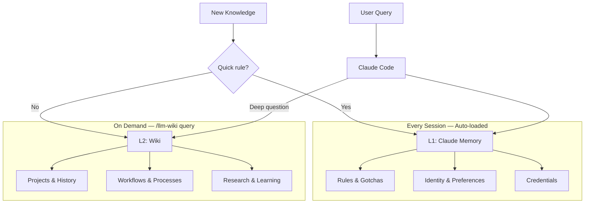
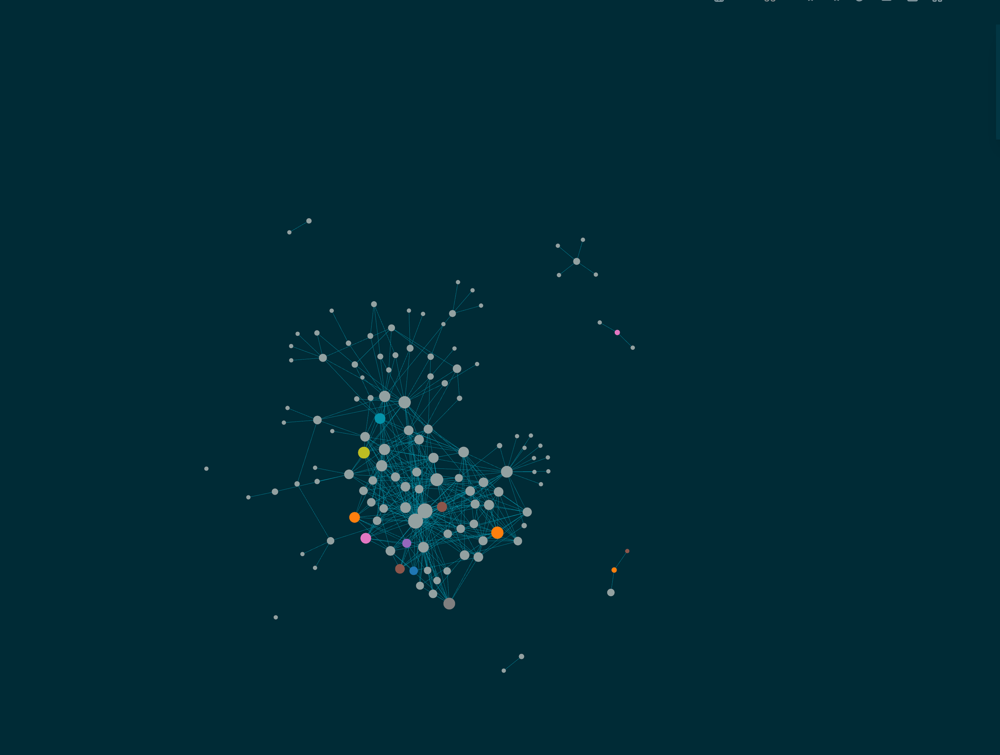
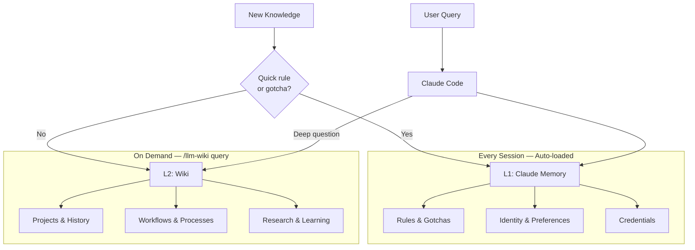
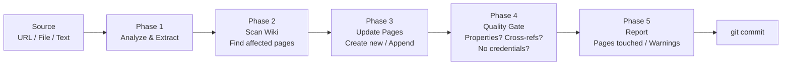

# llm-wiki

[](LICENSE)
[](https://github.com/MehmetGoekce/llm-wiki/releases)
[](https://github.com/MehmetGoekce/llm-wiki/stargazers)
[](https://github.com/MehmetGoekce/llm-wiki)
[](https://github.com/MehmetGoekce/llm-wiki/commits)

Build [Karpathy's LLM Wiki](https://gist.github.com/karpathy/442a6bf555914893e9891c11519de94f) with Claude Code. Two-layer cache architecture (L1/L2). Supports Logseq and Obsidian.



## What is this?


*Your wiki after a few ingests — interconnected knowledge pages in Logseq's graph view.*

In April 2026, Andrej Karpathy published a gist called "LLM Wiki" that got 5,000+ stars in days. The idea: let an LLM maintain a structured, cross-referenced wiki for you. Feed it raw sources, it extracts facts, links them together, and keeps everything consistent. The wiki becomes a persistent, compounding artifact instead of a graveyard of stale notes.

Everyone loved the concept. Almost nobody built one. The gist describes *what* to build, not *how* to wire it up with real tools, real files, and real workflows. **llm-wiki** is the implementation. It uses Claude Code as the LLM brain and either Logseq or Obsidian as the wiki UI, with a two-layer cache architecture that turned out to be the key insight Karpathy's gist does not mention.

## Why use this?

- **5-minute setup.** Install the plugin, run `/llm-wiki setup`, and you have a schema, namespaces, and git tracking. No manual design needed.
- **Claude becomes your wiki maintainer.** `/llm-wiki ingest` updates 5-15 pages with cross-references from a single source.
- **L1/L2 architecture.** Auto-loaded rules in memory (L1) + deep knowledge in the wiki (L2). No other tool has this.
- **Built-in quality checks.** `/llm-wiki lint` finds orphan pages, stale content, broken refs, and credential leaks.
- **Logseq + Obsidian.** Use whichever you already have. No tool switch required.

## Quick Start

### As a Claude Code plugin (recommended)

```bash
claude plugin marketplace add MehmetGoekce/llm-wiki
claude plugin install llm-wiki@mehmetgoekce
```

On Claude Code 2.1.275 or later, one line inside a session does the same:

```
/plugin install llm-wiki --marketplace MehmetGoekce/llm-wiki
```

Claude Code asks for one value, the **Wiki root**: your Logseq graph or Obsidian vault. The directory
may be empty or not exist yet. Then, in any project:

```
/llm-wiki setup
/llm-wiki ingest "your first source"
/llm-wiki query "what do I know about X?"
/llm-wiki lint
```

`/llm-wiki setup` asks which tool you use and which namespaces you want, then creates the Schema,
Dashboard, hub pages, Access-Log and `llm-wiki.yml`. The wiki starts sparse and gets denser with
every ingest. New releases reach you through the plugin; nothing to copy.

Tested with Claude Code 2.1.296.

### Without the plugin

```bash
git clone https://github.com/MehmetGoekce/llm-wiki.git
cd llm-wiki
./setup.sh
```

`setup.sh` asks the same questions in the terminal, creates the same pages, and can copy the skill
into one project's `.claude/commands/wiki.md`. That copy is invoked as `/wiki <command>` and does not
update itself.

The rest of this README writes `/llm-wiki <command>`. With a copied skill, type `/wiki <command>`.

### Moving from a copied skill to the plugin

Install the plugin, enter your existing wiki directory as Wiki root, and delete the copied
`.claude/commands/wiki.md` from your project. The wiki itself needs no change.

### Coming from v1.6.0

The plugin's commands lost their second part: `/llm-wiki:wiki ingest` is now `/llm-wiki ingest`, and
`/llm-wiki:setup` is now `/llm-wiki setup`. Update the plugin and use the new names.

## The L1/L2 Architecture

This is the part not in Karpathy's gist, and it turned out to be the most important design decision.

When you start building a wiki, the instinct is to put everything in one place. That is wrong. Some knowledge must be available in *every* session, before you even ask a question -- things like "max 2-3 SSH calls to the VPS, never 10+" or "always use ISO 8601 dates." If the LLM has to query the wiki to learn these rules, it has already made the mistake.

Other knowledge only matters in specific contexts. The full history of a project. A detailed API workflow. Loading all of this into every session wastes the context window.

The solution maps to a concept every engineer knows: **CPU cache hierarchy.**

| Layer | What | Size | Loading | Contains |
|-------|------|------|---------|----------|
| **L1** | Claude Code Memory | ~10-20 files | Auto-loaded every session | Rules, gotchas, identity, credentials |
| **L2** | Wiki (Logseq/Obsidian) | ~50-200 pages | On-demand via `/llm-wiki query` | Projects, workflows, research, deep knowledge |



**The routing rule is simple:** Would the LLM making a mistake without this knowledge be dangerous or embarrassing? Then it belongs in L1. Would the mistake be merely inconvenient? Then L2.

Credentials are a special case -- they *must* live in L1 because the wiki is typically git-tracked. The L1 memory directory is excluded from git, making it the only safe place for secrets.

For the full deep-dive, see [docs/l1-l2-architecture.md](docs/l1-l2-architecture.md).

## Commands

| Command | Description |
|---------|-------------|
| `/llm-wiki ingest <source>` | Process a source (URL, file, text), update 5-15 wiki pages |
| `/llm-wiki query <question>` | Two-stage search via hub index, synthesize answer with source attribution |
| `/llm-wiki prune [--months N]` | LRU-Demote: evict cold pages from the live index (default 6 months) |
| `/llm-wiki prune --l1` | L1-Verification: classify L1 rules, check due behavior claims against local evidence, re-verify / demote / delete |
| `/llm-wiki lint [--fix]` | Health check: orphans, stale pages, broken refs, index drift, credential leaks, due L1 claims |
| `/llm-wiki status` | Metrics dashboard: page count, health, hot/cold profile, recent changes |

### Ingest Flow

Ingest is the core operation. When you run `/llm-wiki ingest "deployed v2.0 to production"`, here is what happens:



**Phase 1 -- Analyze & Extract.** Claude reads the source and extracts entities, facts, relationships, and dates. It classifies each piece by domain (business, technical, content, etc.) and checks whether it belongs in L1 (quick rule) or L2 (deep knowledge).

**Phase 2 -- Scan Wiki.** Claude reads the schema, then scans existing pages to find which ones the new information affects. If you mention a tool that already has an entity page, it knows to update that page too.

**Phase 3 -- Update Pages.** New pages get all required properties from the schema. Existing pages get new facts *appended*; when a fact supersedes a stated state (a status, a deadline, a decision), the block is rewritten and the old wording moves into a collapsed `History` -- nothing is deleted, and the current state stays on top. Target: 5-15 page touches per ingest.

**Phase 4 -- Quality Gate.** Before committing: Do all pages have required properties? Does every page have at least one cross-reference? Are there credential patterns in the content?

**Phase 5 -- Report.** Summary of pages created, updated, cross-references added, and any warnings.

### Query

Query is **two-stage**, the way a CPU resolves an address before touching memory. **Stage 1 (routing):** Claude reads only the hub `### Index` pages of the candidate namespaces — a cheap list of routing lines (`[[page]] -- description #tags`) — and picks the 3 most relevant pages by description. This is the wiki's *page table*. **Stage 2 (read):** it opens only those full pages and synthesizes an answer with source attribution. A full-text grep over every page is the **L3 fallback**, used only when routing finds nothing. Each full-page read is logged to an append-only Access-Log together with the routing reason it was picked (the matched index description or grep term) — so the log records not just *what* loaded but *why*, and it feeds `prune`. If the query reveals a gap, it offers to create a new page.

### Prune

Prune is the eviction layer that keeps routing precise as the wiki grows. It reads the Access-Log, finds **cold pages** (no read in N months, default 6), and evicts them from the live index — the routing line moves from the hub `### Index` to `### Archive` and the page is marked `archived::`. This is **demotion, not deletion**: the file stays in place, every incoming `[[link]]` stays valid, and the page is still found by the L3 grep fallback (and re-promoted automatically if queried again). Crucially, prune never renames or moves a file — the wiki tool links by page name, so a move would break every backlink. Run it on a schedule (the command does not self-schedule).

**`--l1` is the L1 counterpart.** Access frequency cannot find stale L1 rules — every L1 file loads every session, so a stale rule never looks cold; it shows up as the agent confidently acting on an outdated assumption. So L1 files carry a claim class: `asserts-current-behavior: true` for claims about a system's current state (a path, flag, version, quirk) and `false` for decisions and preferences, which never go stale. Behavior claims carry a `verified` date. `/llm-wiki prune --l1` classifies unclassified files (it proposes, you confirm), checks due claims against read-only local evidence, and lets you re-verify, demote the rule to L2 as history, or delete it. It does not warn mid-session when a stale rule is about to justify an action — Claude Code loads L1, so there is no hook for that; it is on the roadmap.

### Lint

Lint is the automated health check. It scans every wiki page and checks 13 rules: orphan pages (no incoming links), stale content (last updated 90+ days ago but still marked high-confidence), missing required properties, broken references, hub completeness, **index drift** (an active page with no routing line, or a routing line with no page), **archived-in-live-index** (a demoted page still routed), empty pages, weak cross-referencing, credential patterns, L1/L2 duplicates, **due L1 claims** (behavior claims whose `verified` date is missing or older than `l1_verify_days`), and **block bloat** (a block grown past 600 characters of prose, or an `updated::` value used as a change log). Run with `--fix` and Claude auto-repairs what it can — including backfilling missing routing lines into hub indexes.

## The Schema

The schema is the contract between you and the LLM. Without it, the LLM creates inconsistent pages -- one uses `status: active`, another `state:: running`, a third has no status field at all. With a schema, every page follows the same structure and automated quality checks become possible.

The schema defines:

- **8 namespaces** (Business, Tech, Content, Projects, People, Learning, Reference, Careers)
- **5 page types** (Entity, Project, Knowledge, Feedback, Hub) with required properties
- **Lint rules** for automated health checks
- **L1/L2 boundary** so the system knows where new knowledge should be routed

For the complete schema reference, see [docs/schema-reference.md](docs/schema-reference.md).

## Logseq vs. Obsidian

Both wiki apps are supported. Choose based on your preference:

| | Logseq | Obsidian |
|---|--------|----------|
| **Properties** | `property:: value` (inline) | YAML frontmatter |
| **Format** | Outliner (`- ` prefix on every line) | Flat markdown |
| **File names** | `Wiki___Tech___Strapi.md` | `Wiki/Tech/Strapi.md` |
| **Links** | `[[Wiki/Tech/Strapi]]` | `[[Wiki/Tech/Strapi]]` |
| **Backlinks** | Automatic (graph-native) | Via plugin or core feature |
| **Block addressing** | Every line is a block | Paragraph-level |
| **License** | AGPL-3.0 (open source) | Proprietary (free for personal use) |

**Logseq** shines when the LLM is doing the writing -- its outliner format means every block is independently addressable, so appending new content never disrupts existing structure.

**Obsidian** is better if you do a lot of manual editing -- flat markdown is more natural to write by hand, and the plugin ecosystem is massive.

For a detailed comparison with migration paths, see [docs/logseq-vs-obsidian.md](docs/logseq-vs-obsidian.md).

## Before & After

The difference between a dead wiki and a living one is page quality.

**Before** -- a placeholder created when the page was first made:

```markdown
- type:: knowledge
- domain:: content
- ## Newsletter
  - To be filled via /llm-wiki ingest.
```

**After** -- synthesized from multiple sources over several ingest operations:

```markdown
- type:: knowledge
- domain:: content
- confidence:: high
- created:: 2026-03-15
- updated:: 2026-04-07
- ## Company Newsletter
  - Monthly newsletter targeting existing clients and prospects.
  - ### Metrics
    - | Metric | Value | As of |
      |--------|-------|-------|
      | Subscribers | ~240 | 2026-04-01 |
      | Open rate | 38% | 2026-04-01 |
      | Cadence | monthly | -- |
  - ### Content Strategy
    - 1 technical deep-dive + 1 business insight per issue
    - Always include a CTA to the latest blog post
    - Subject lines: question format performs 2x better
  - ### Open Questions
    - Segment list by industry vertical?
    - A/B test send time (Tuesday AM vs Thursday AM)?
  - ### Cross-References
    - [[Wiki/Content/Blog]] -- Source content
    - [[Wiki/Content/LinkedIn]] -- Promotion channel
    - [[Wiki/Reference/Workflows]] -- Publishing workflow
```

Every number has a date. Decisions have rationale. Open questions are explicit. Cross-references connect to related pages.

## Configuration

Setup creates `llm-wiki.yml` in your wiki root. You can also create it manually:

```yaml
# llm-wiki.yml

tool: logseq          # or "obsidian"
wiki_path: ~/Documents/MyWiki/
pages_dir: pages      # relative to wiki_path
memory_path: ~/.claude/projects/my-project/memory/
l1_verify_days: 90    # optional: re-verify L1 behavior claims after N days

namespaces:
  - Business
  - Tech
  - Content
  - Projects
  - People
  - Learning
  - Reference
  - Careers

# Lint settings
lint:
  stale_threshold_days: 90
  min_cross_refs: 1
  credential_patterns:
    - "token::"
    - "password::"
    - "secret::"
    - "api.key::"

# Ingest settings
ingest:
  target_page_touches: [5, 15]   # min, max pages per ingest
  append_only: true              # never delete content; superseded state moves to a collapsed History

# Language (for multilingual wikis)
language:
  business: en    # Language for business content
  tech: en        # Language for technical content
```

## Trade-offs

No system is perfect. Some things to know:

- **The schema feels overengineered at first.** With 10 pages, defining 5 page types and 8 lint rules seems like overkill. Past 50 pages, you will be grateful for the consistency. Define the schema early -- it is much harder to retrofit one later.
- **Two systems means you need a clear boundary.** Having both L1 and L2 means you could accidentally put the same information in both places. The lint rule for L1/L2 duplicates exists precisely for this reason.
- **Parallel agents can conflict.** If you have multiple Claude sessions writing to wiki files simultaneously, concurrent edits can cause conflicts. Treat wiki files as a shared resource.
- **Start with fewer hub pages.** Let them emerge organically from ingest operations rather than creating empty hubs upfront.

## Documentation

- [FAQ](docs/faq.md) — Common questions before you install
- [Troubleshooting](docs/troubleshooting.md) — Setup, integration, and runtime issues
- [L1/L2 Architecture](docs/l1-l2-architecture.md) — Why two layers, how to route knowledge
- [Schema Reference](docs/schema-reference.md) — Page types, properties, lint rules
- [Logseq vs. Obsidian](docs/logseq-vs-obsidian.md) — Detailed comparison and migration notes

## Privacy

llm-wiki has no backend and collects nothing. It is a skill and a few shell scripts that run inside your own Claude Code session.

- Wiki pages, the access log and `llm-wiki.yml` are written to your local Logseq graph or Obsidian vault and stay there. Whatever you ingest ends up in those files, including names or contact details if the source contains them.
- If you set `memory_path`, the skill also reads your local Claude Code memory directory: `query` may consult it, `lint` reports rules that are due for a check, and `prune --l1` classifies, updates, moves or deletes memory files, each one only after you confirm it. `lint` never prints the content of a memory file. Without `memory_path` the skill does not touch that directory.
- The skill and the scripts send nothing to the author or to any third party. There is no telemetry.
- The only network access is the page fetch that `ingest` makes when you pass a URL as the source.
- Commits are local. Nothing is pushed unless you push your wiki yourself.
- Claude reads the content you work with in order to do the work. That processing is covered by your own Claude plan and Anthropic's terms, not by this plugin.

## Credits

- Inspired by [Andrej Karpathy's LLM Wiki gist](https://gist.github.com/karpathy/442a6bf555914893e9891c11519de94f)
- Built with [Claude Code](https://claude.ai/code)
- Works with [Logseq](https://logseq.com/) and [Obsidian](https://obsidian.md/)

## License

MIT -- see [LICENSE](LICENSE) for details.
