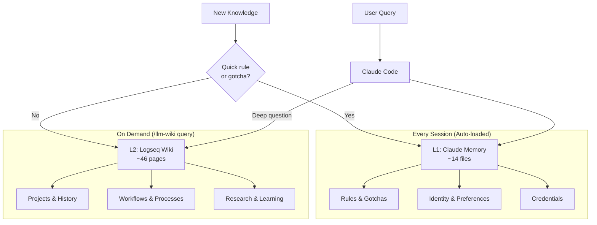
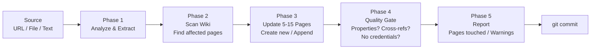

# Architecture Diagrams

Mermaid diagrams of the main flows. GitHub renders them in place.

## L1/L2 architecture

What loads every session (L1) and what is read on demand (L2), and how new knowledge is routed.



## Ingest flow

The five phases of `/llm-wiki ingest`.



## Query routing

Two-stage routing of `/llm-wiki query` through the hub indexes, the L3 fallback, and how the
Access-Log feeds `/llm-wiki prune`.

```mermaid
graph LR
    Q[Question] --> P0[Phase 0<br/>Routing<br/>Read hub Index only]
    P0 --> PICK{Routing line<br/>matches?}
    PICK -->|Yes| P1[Phase 1<br/>Read chosen<br/>3-5 full pages]
    PICK -->|No match| L3[L3 Fallback<br/>Full-text grep<br/>over all pages]
    L3 --> P1
    P1 --> LOG[Phase 1b<br/>Append to Access-Log<br/>one line per read]
    LOG --> SYN[Phase 2<br/>Synthesize<br/>+ source attribution]
    LOG -. feeds .-> PRUNE[/llm-wiki prune<br/>evict cold pages]
    PRUNE -. demote .-> ARCH[Hub Archive<br/>archived:: marker<br/>file stays, links intact]
```
